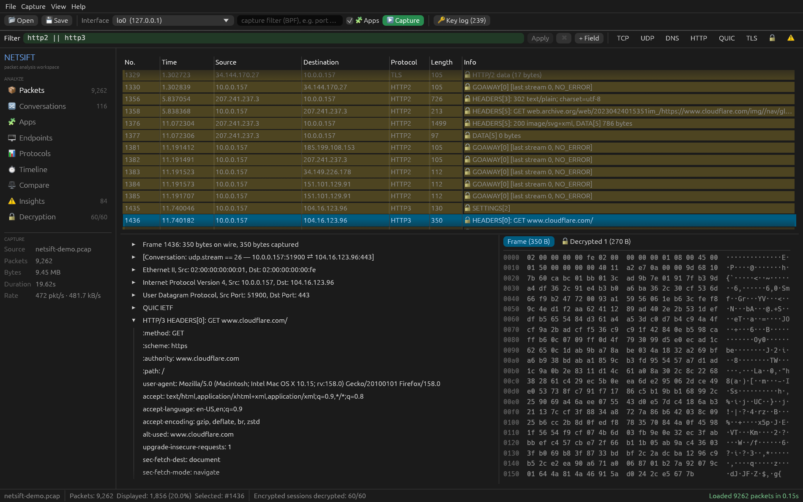

# NetSift

A fast packet analyzer for macOS and Linux: live capture and pcap/pcapng, live decryption of HTTPS, HTTP/2 and HTTP/3, which app sent each connection, a request waterfall with HAR export, and capture diffs. Part of the [Cydra Suite](https://nyanites.github.io/) by Cydraintel.

**Website:** <https://nyanites.github.io/netsift/>



## Install

```sh
curl -fsSL https://nyanites.github.io/netsift/install.sh | sh
```

macOS 11+ (universal app for Apple Silicon and Intel) or Linux x64/ARM64 (glibc 2.35+). The installer downloads the latest [release](https://github.com/Nyanites/netsift/releases), verifies its SHA-256 checksum, installs for your user only and never asks for your password. Windows support is planned (it needs Npcap).

## Build from source

Needs a recent stable Rust and libpcap (built into macOS; `libpcap-dev` on Debian/Ubuntu).

```sh
cargo run --release                                   # welcome screen
cargo run --release -- capture.pcapng                 # open a file
cargo run --release -- capture.pcap --keylog keys.log # open + decrypt
```

If `SSLKEYLOGFILE` is set in the environment, NetSift loads that key log on startup. You can also drop capture files or key logs onto the window. To try decryption right away, open `marketing/demo/netsift-demo.pcap` with `marketing/demo/netsift-demo-keys.log`: a real Firefox session with TLS 1.2/1.3, HTTP/2 and HTTP/3 (addresses anonymized).

**Live capture** needs packet-capture permission. On macOS that's read access to `/dev/bpf*`: install Wireshark's ChmodBPF helper, or run `sudo chmod o+r /dev/bpf*` (resets on reboot). On Linux, grant the capability once: `sudo setcap cap_net_raw,cap_net_admin=eip $(which netsift)`. NetSift never needs to run as root.

## Layout

| Area | Purpose |
|---|---|
| Toolbar | Open/save, pick an interface, set a BPF capture filter, start/stop (⌘E), load a key log |
| Filter bar | Display filter with live validation, a `+ Field` inserter, and one-click presets (TCP, UDP, DNS, HTTP, TLS, 🔓 decrypted, ⚠ problems, ★ bookmarks) |
| Left panel | Packets, Conversations, Endpoints, Protocols, Insights, Decryption, and the stream you are following, plus capture stats and bookmarks |
| Packets | Colour-coded list; details tree and hex dump linked both ways (click a field to highlight its bytes, click a byte to find its field); decrypted records get their own tabs |
| Follow stream | Double-click a packet. Switch between raw bytes, decrypted TLS, and decoded HTTP/2 or HTTP/3 messages; client data is red, server data is blue |

Right-click packets, fields, conversations and endpoints for filter and follow actions. Keys: ↑/↓ to move through packets, ⌘F to focus the filter, ⌘M to bookmark, ⌘O to open, ⌘S to save.

## Timeline, HAR, Compare

- **Timeline** (⌘T): every HTTP/1.x, HTTP/2 and HTTP/3 request (plain or decrypted) as a browser-devtools-style waterfall showing connection setup, server wait and download. Drag across the time axis to zoom; click a request to jump to its packet.
- **HAR export** (Timeline or File menu): saves those requests, with headers, timings and uncompressed bodies, as an HTTP Archive for Chrome/Firefox devtools and HAR viewers.
- **Compare** (File → Compare with another capture…): matches packets between two captures of the same traffic (e.g. client side vs server side) on ports, TCP sequence numbers, flags and payload, ignoring TTL, IP ID, checksums, link headers and NAT. It shows what went missing, what appeared, and the delay between the capture points. `compare.missing` filters to the missing packets.

## Command line

```sh
netsift query big.pcap -f 'tls.sni contains "github"' [-k keys.log] [-c] [-w out.pcap]
netsift sessions capture.pcap -k keys.log      # TLS/QUIC sessions and decryption status
netsift http capture.pcap -k keys.log          # requests with timings
netsift har capture.pcap -k keys.log -o out.har
netsift diff client.pcap server.pcap
```

## Performance

Benchmark: a 1.03 million packet / 1.0 GB capture built from real Firefox traffic, on an Apple M4 Pro, against tshark 4.6.8:

| | NetSift | tshark |
|---|---|---|
| Each search after loading | **8–73 ms** (all cores) | full re-read, 4.5–5.3 s |
| Load + search, decrypting HTTPS/HTTP/3 | **7.4 s** | 11.1 s |
| Load + search, no decryption | 5.6 s | **4.5–5.3 s** |
| Peak memory | 3.2 GB (5.7 GB decrypting) | **1.0 GB** (2.2 GB) |

## Apps: which program sent this traffic?

During a live capture NetSift attributes each connection to the local process that owns it. Wireshark has had open requests for this since bug 1184. You get:

- a **Process** column in the packet list and Conversations
- an **Apps** view showing traffic per application (helpers grouped under their app, e.g. "Code Helper" → Visual Studio Code), with bytes sent and received and the hosts each app talks to
- filters such as `process == "curl"`, `app == "Google Chrome"`, `pid == 4242` and `!process`

There are two sources:

| Source | Needs | Coverage |
|---|---|---|
| Socket-table watcher (libproc on macOS, `/proc` on Linux), polled every 100 ms | nothing extra | your own processes; root sees all. Earlier packets of a connection are back-filled once it is identified. |
| Kernel per-packet metadata (macOS PKTAP via `pcap_set_want_pktap` + extended headers) | macOS | direction and service class for every packet; the exact process per packet for your own traffic, and for everything when root |

Toggle it with **🧩 Apps** in the toolbar. **🔑 → Launch Firefox/Chrome with decryption** starts a browser with key logging, loads its key log and starts capturing in one click. Process information is not written to saved `.pcap` files yet. PKTAP capture files (link types 149/258) are read and dissected.

## Decryption

TLS and QUIC are decrypted using an NSS key log (`SSLKEYLOGFILE`), which Chrome, Firefox, curl, OpenSSL, BoringSSL, NSS, rustls and quinn can all write:

- TLS 1.3: `TLS_AES_128_GCM_SHA256`, `TLS_AES_256_GCM_SHA384`, `TLS_CHACHA20_POLY1305_SHA256`, including KeyUpdate
- TLS 1.2: ECDHE/DHE/RSA with AES-GCM and ChaCha20-Poly1305
- Encrypted Client Hello (ECH): keys are logged under the hidden inner ClientHello's random, so NetSift finds them by verifying candidate secrets against the first encrypted record
- QUIC v1 and v2: header protection, coalesced packets, packet-number recovery and 1-RTT key updates (0-RTT too, when the key log has `CLIENT_EARLY_TRAFFIC_SECRET`). Initial packets decrypt with no keys at all, so every QUIC connection's ClientHello (SNI and offered ALPN) is visible even without a key log.

The key log is re-read whenever it changes, so sessions decrypt during a live capture as soon as the browser writes their keys. Packets that arrived before their keys are decrypted retroactively.

## HTTP

| Version | Transport | Headers |
|---|---|---|
| HTTP/1.x | TCP, or decrypted TLS | Fully dissected |
| HTTP/2 | Decrypted TLS (ALPN `h2`) or cleartext h2c | HPACK: static and dynamic tables, Huffman, CONTINUATION |
| HTTP/3 | Decrypted QUIC | QPACK: static and dynamic tables via the encoder stream, blocked streams |

Decoded requests and responses appear in the Info column (for example `HEADERS[3]: GET example.com/api`). Their headers show in the details pane, and **Follow → HTTP messages** gives a readable request/response view. `http.host`, `http.request.method`, `http.request.uri` and `http.response.code` filter across all three versions.

Not decrypted: TLS CBC suites, SSH, WireGuard and IPsec. They are listed under Decryption with the reason.

## Display filters

```
tcp && ip.addr == 10.0.0.0/8
dns.qry.name contains "apple" || http.response.code >= 400
http3 && http.request.method == "POST"        quic && !decrypted
tls.sni contains "google" && !decrypted
tcp.stream == 3        tcp.flags.syn && !tcp.flags.ack
frame contains "password"        frame contains de:ad:be:ef
192.168.1.10           (shorthand for ip.addr == …)
```

The full reference is under Help → Display filter reference.

## Tests

`cargo test` checks decryption against real protocol stacks:

- rustls TLS 1.2 and 1.3 handshakes for every supported cipher suite, including out-of-order and duplicate segments
- HTTP/2 traffic from the `h2` crate, both cleartext and over TLS
- QUIC + HTTP/3 traffic from quinn + h3, recorded through a UDP relay, for all three cipher suites, with a forced key update and a key log loaded after the fact
- RFC 7541 (HPACK) and RFC 9001 (QUIC keys and header protection) test vectors
- a randomized robustness test that feeds garbage and mutated traffic to the parsers
- socket-table snapshots seeing the test's own connections (native libproc), and `/proc/net` parsing

Run `cargo test --release -- --ignored ingest` for the ingest benchmark. `cargo test -- --ignored live_` runs live-capture tests. They need capture permission (root, or Wireshark's ChmodBPF) and check that real connections, including a short-lived `curl`, are attributed to the right process.

## License

NetSift is source-available under the [PolyForm Small Business License 1.0.0](LICENSE.md): free for organizations with fewer than 100 people and under US$1M in revenue. Larger organizations need a commercial license; [get in touch](https://github.com/Nyanites/netsift/discussions). Third-party notices are in [NOTICE.md](NOTICE.md); security reports go through [SECURITY.md](SECURITY.md).
